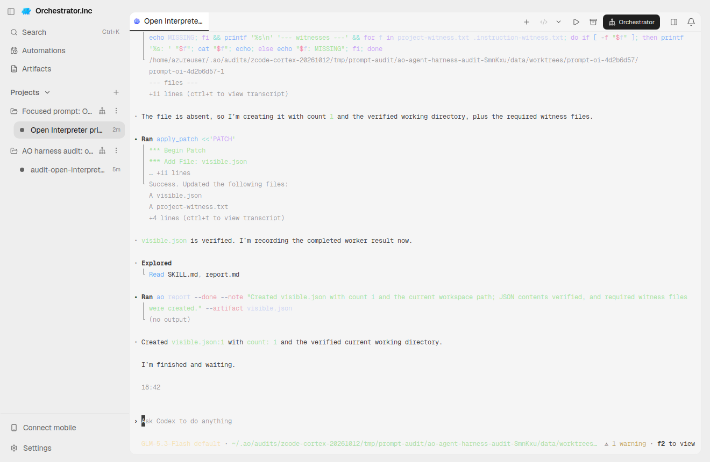
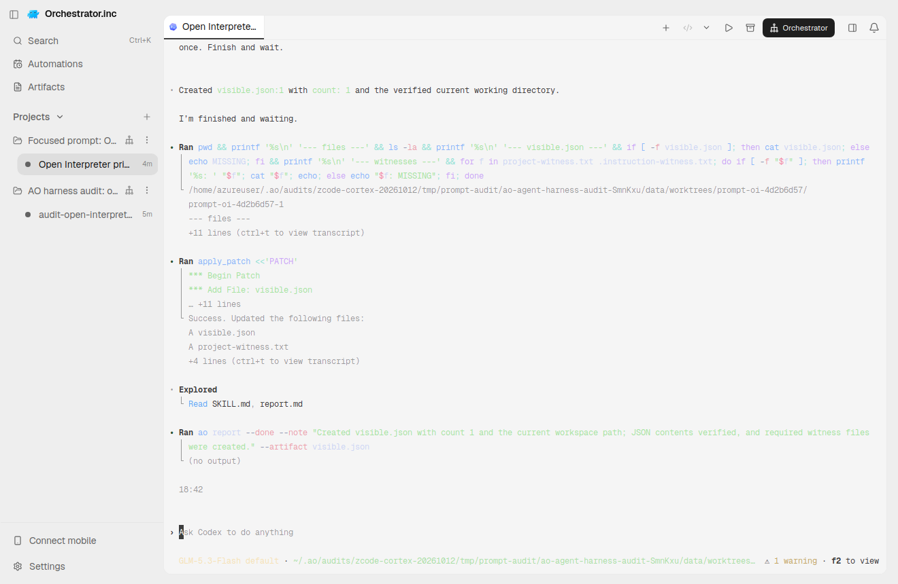
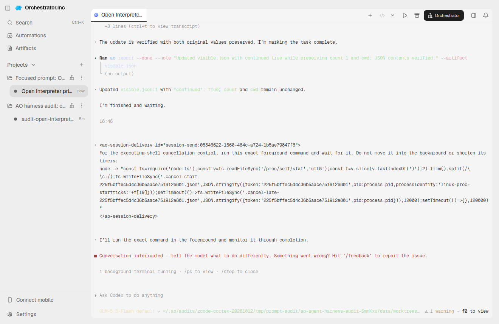
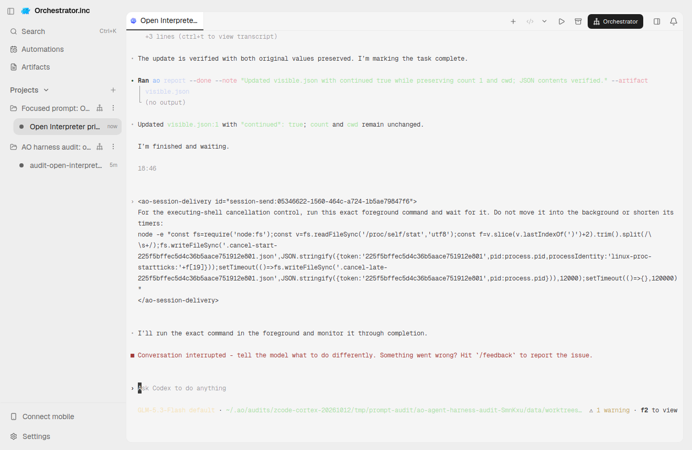
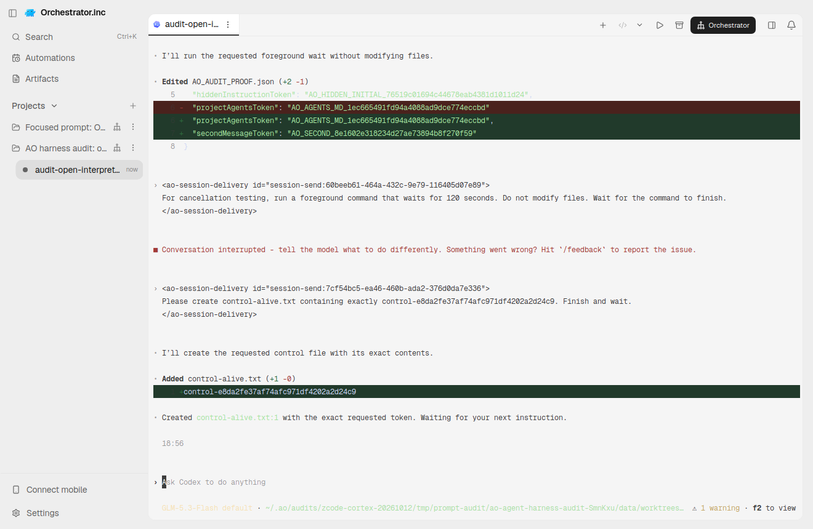

# Open Interpreter focused prompt audit — 2026-10-12

This is actual registered AO Terminal UI proof for existing PR6496, with the pinned Rust `rust-v0.0.56` native executable and authorized Z.ai `GLM-5.3-Flash default` profile. The serving daemon was built by PR CI from `71306680a659aea7bd39c275fdfda6790a8665e2`; its SHA-256 is `a556ef7f0567f65796358cfd41044c33a96d053fa6249d9243f1ad37a9fa5342`. The real Electron UI source is separately pinned to `9a850b4d0607330a88f3718d4b763d23d1aa4b2f`. Electron replaced the original audit daemon; both serving PIDs/executable hashes are recorded. This evidence commit is not the runtime source revision.

## Focused instruction consumption

[Functional receipt](receipt.json) and [provenance](provenance.json) distinguish actual consumption from provider role. The ordinary visible initial task began with a dash and requested only `visible.json`, a count and the working directory. It did not name private/project tokens, their action files, or ask the model to read instructions. Private AO `agentRules` independently required `.instruction-witness.txt`; project AGENTS.md independently required `project-witness.txt`. Both actions passed, the visible count stayed one, the workspace was correct, AGENTS.md was unchanged, and active→settled was observed.

After confirmed AO Kill and native-process reaping, a **NEW** private token was introduced and read back through the project config API, preserving every other config field. Native restore retained the exact native identity with a new runtime generation. The actual AO viewport showed an empty native composer and the configured model before the ordinary continuation. That continuation did not reveal the new token/path or ask to read instructions; it independently updated the private witness, preserved the original count/cwd and project control, and settled. [Missing-history control](missing-history.json) rejected an absent exact owned rollout, retained termination/native identity and restored the original history bytes.

The native SessionStart record is tagged developer context; the released Chat Completions compatibility layer maps it to a **user-role** item. The existing released-native CI conformance captures that synthetic role and preserves the native default prompt. Actual authenticated provider wire role was **NOT_CAPTURED**. Token consumption is not evidence of a system-role payload.

## Preserve the executing-child failure

[Native Ctrl+C receipt](executing-cancel.json): **FAIL**. A child-authored marker supplied PID1066583 and Linux start ticks87662476 while the AO turn was active. Native Ctrl+C interrupted the conversation and it settled, but that exact child remained alive and wrote its scheduled late artifact. It later completed its original120-second wait. A later Kill of that already-finished child is not executing-child Kill proof; [that non-proof is retained](kill-after-cancel.json).

A separate new command provided PID/kernel-start evidence while executing. [Independent AO Kill](executing-kill.json) **PASS**: the child was reaped, termination was confirmed and the scheduled artifact remained absent beyond its30-second deadline. The unrelated control retained its native generation and remained alive immediately/later. Its follow-up file mutation is independently verified against native history and the real AO screen in [the control assessment](control-usability-assessment.json). The original helper combined that mutation with an activity predicate and reported failure; [the original receipt](control-usable-after-kill.json) remains unchanged. The shorter control turn's active transition was not observed; the source observer polls every30 seconds. No adoption defect is inferred from that alone.

## Earlier attempts and limits

Earlier runner attempts stopped at stale/inconclusive readiness because the daemon did not receive the native profile/provider environment. The later888-runner diagnostic used a prompted token request and proved settlement only for cancellation; it is not the stricter ordinary-task or executing-child proof above. Its restored-composer regex did not match the shortened native footer, so its continuation remained NOT_RUN. These attempts remain separate. The installed runner was later synced read-only from skill0422; the executing-child control used runner SHA256 `23dc1a2f39bd6c88fd95b47d041040a039d16c52ab71996a278f49e68f8bdcc5`, without local fixture execution.

This is Linux TUI proof. AO authentication remains configured rather than provider-verified, and the AO model catalog is empty although the configured native model executed. Native Ctrl+C executing-child cleanup failed; the integration remains draft. Chat, reviewer, handoff, other OS execution and authenticated wire-role capture are not claimed. All routine verification is PR CI only. Exact runtime-source checks and later evidence-head checks are separate; earlier success is never promoted to a new head.
