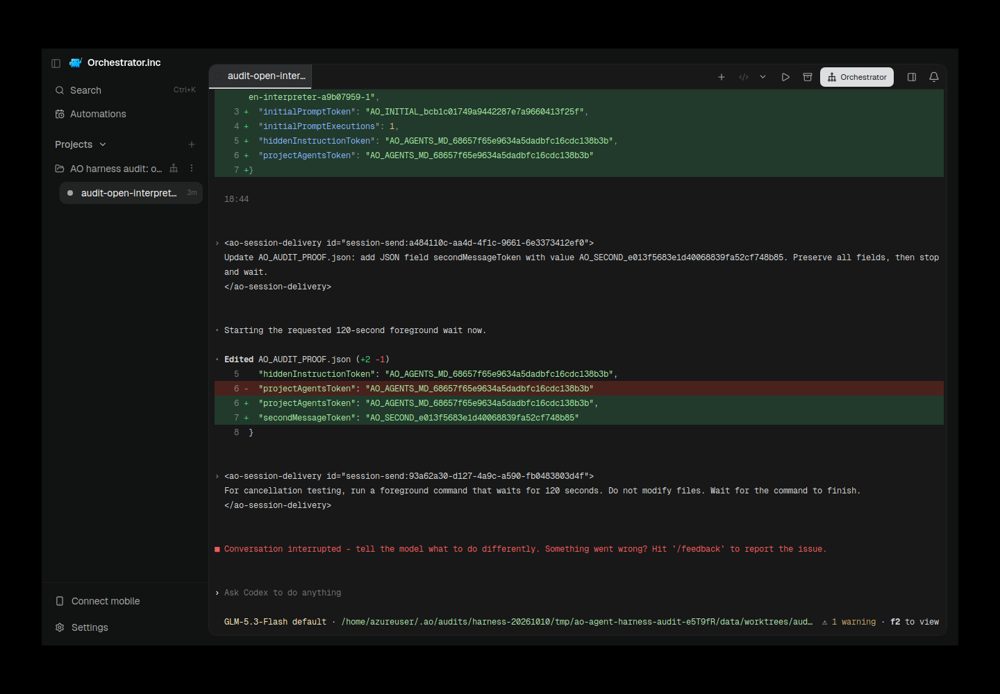
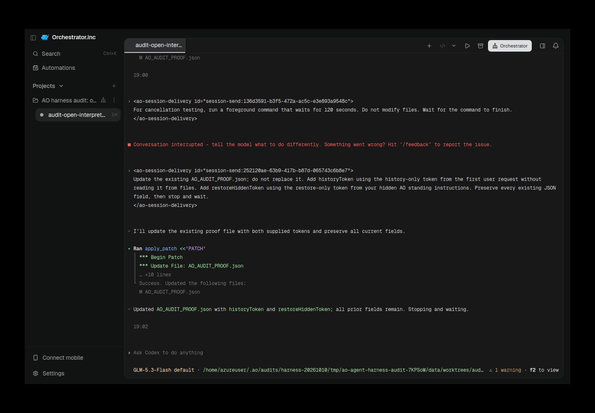

# Rust Open Interpreter fresh restore and real AO evidence — 10 October 2026

Official **Rust Open Interpreter 0.0.56**, not Python; pinned release archive SHA-256 `9e859353d6e2af28381489570d3ecf02060f7c73df5a652f3ca60c196835ccac`, reinstalled from the exact CI-pinned official URL because the earlier native runtime was removed. Existing authorized Z.ai profile/model `glm-5.3-flash`, explicit native bypass in isolated audit only. All builds/tests/provider calls/real Electron capture on the VPS, sequential under compute lock.

| Attempt | Functional source | PASS | FAIL | BLOCKED | NOT_RUN |
| --- | --- | ---: | ---: | ---: | ---: |
| open-interpreter-001 | `88c7431c427dda8c08802e9612042545a4febaf3` | 19 | 2 | 2 | 5 |
| open-interpreter-002 | `330590df92575a958dc7a507d16654079b17b4fa` | 24 | 1 | 1 | 2 |

The corrected run finished `2026-10-10T19:02:25.394Z`. **Every functional lifecycle gate passed**; strict overall remains **FAIL / diagnostic-only** because the model API returns HTTP200 with an empty catalog. Authentication is configured, not verified: BLOCKED. Native model-list and local/AO comparison remain NOT_RUN. No login, invented catalog or gate relabeling. Existing provider selection/credential reused; the existing native launcher added trust only for the new runner-owned scratch workspace/repository paths.

## Preserved failures and evidence-derived fix

Attempt001 wrote the project AGENTS token into hiddenInstructionToken instead of the standing-instruction token. Native developer history contained a roughly10KiB preview with a `Full hook output saved to:` footer and omitted the expected token. The production AO callback independently emitted valid15KiB context including the instruction assignment, so callback formatting was not missing. This is a real integration defect: released native hooks default to a **2,500-token preview retaining both ends**, spilling the complete output to a file. AO role/skill text puts instructions in the omitted middle; relying on the model to discover/read a spill file failed.

[Native source at the pinned revision](https://github.com/openinterpreter/openinterpreter/blob/cc054cf52fa3585a3de50e0d4e0be6f9ee6677e8/codex-rs/hooks/src/output_spill.rs). Fix `330590df92575a958dc7a507d16654079b17b4fa` sets the documented `additionalContextLimit=0` **only for AO's SessionStart definition**, includes it in the canonical exact-definition trust hash, and preserves other hook defaults/trust. It does not replace provider defaults or enable a global hook-trust bypass.

The released-native conformance test now places its marker in the **middle** of a19KiB context. Before fix it failed with `model request missing AO_PRIVATE_CONTEXT`; after fix the entire native adapter suite including released TUI conformance passed. An earlier tail-only control passed because preview retains ends; that weak control is preserved rather than called a successful regression. One green launcher invocation used the wrong working directory and failed before tests; preserved separately and corrected. Unit coverage also verifies that only SessionStart changes its limit and its exact normalized trust hash remains valid.

Attempt001's restored-readiness contract also timed out. Its pattern matched a rendered native screen but not the raw mux redraw: cursor positioning concatenated rows and native warning/border characters. The runner correctly sent **no continuation**, retaining post_restore_message/history_file_continuity/system_prompt_restore as NOT_RUN. The fresh contract is derived from the observed raw frame: one end-anchored contiguous **empty** composer plus exact initialized model and full audit workspace; exact warning/DEC border variations are accepted. Genuine rendered/raw samples match; loading model, foreign current draft, and old empty frame followed by a current draft are rejected. No draft was cleared.

## Corrected live proof and actual AO UI

Attempt002 introduced a fresh restore-only token **after confirmed kill**, wrote/read back project config through the daemon API, restored the same native ID/workspace, observed the initialized empty composer, then verified mutation/history/fresh standing instructions. Independent native history now has complete developer-context rows with the initial token before kill and the fresh token only in the later restored row, with **no spill footer**. Harmless audit tokens prove consumption, not secrecy or developer-role precedence over Chat Completions compatibility.

AO binary SHA-256 `8d84f311dac085d2b1d9df1c07019b54e6f5d21816b19e4467d3a2ebc4617c42` in a distinct canonical `ao` path; runner `8887aa2e7101b9e6d3950bfca08ffddf2e1e6c1c3f1d030c8dec2676443aecea`; exact UI source matches corrected functional source. AO session `audit-open-interpreter-1b4e895b-1`, native digest `0bd058dae3bfcc86e66555bd2aeb6f10594e019e682d7b343680344da5696756`. Capture-time native digest/restored terminal generation reconfirmed.

Original retained failure captured `2026-10-10T18:48:33.530050Z`, PNG SHA-256 `0f720af3fb8835e7abdd48c2a35ae215b9a500686a6c329959a94ae3d22cb669`; source/UI88c7431, exact old binary recorded in adjacent provenance. Visible proof wrongly repeats the project token, native turn interrupted, empty restored composer. This later retained-session image does not retroactively replace an unavailable original gate-time screenshot.

Corrected retained session captured `2026-10-10T19:04:31.649461Z`, PNG SHA-256 `1df692b9cfdd088808dac4d7ddc5ecd021830ee48e5206085176f83ef9a50d61`. Actual AO Electron/preload bridge, exact session route and native TUI selected, scrot/Xvfb, visually inspected for secrets/relevance. Native UI retains its upstream Ask Codex wording; this is the pinned Rust Open Interpreter process as confirmed by source/binary/session provenance. After finalized runner stopped, Electron reopened identical isolated data with the identical verified binary and recovered the same runtime.

Cancellation proves the observed active native turn was interrupted and AO later settled; it does not prove already-running subprocess reaping or immediate provider socket closure. The native stream reader can outlive cancellation. Capture itself makes no lifecycle assertion.

[Historical failures and early-send reproduction](https://github.com/OrchestratorInc/agent-orchestrator/pull/6496#issuecomment-6095922723) remain unchanged. Historical17/17 did not prove refreshed instructions, and the old terminal mirror was not actual AO UI. The known HTTP200-during-initialization/unsubmitted-draft issue is **not declared fixed** by waiting for initialized readiness in this audit; this follow-up proves the readiness-aware path only.

## Validation and cleanup

Original and corrected functional source each had24/24 exact-head CI PASS. Corrected released-native regression/adapter suite and focused adapter/CLI race suite passed locally. The full non-race VPS suite was interrupted by the supervisor at approximately eight minutes after green CI was independently verified; it is **INCOMPLETE with observed failures**, not a local pass. Failed packages observed before interruption: `internal/adapters/agent/fake`, `internal/adapters/agent/opencodev2`, `internal/httpd/controllers`, `internal/integration`, `internal/service/agent`; exact package names/test names and log hash are preserved in [backend-validation.json](assets/open-interpreter-20261010-followup/backend-validation.json). These failures are untriaged, not labeled baseline or attributed to this fix. Full vet/lint/race were not run on the VPS; those results are CI-only. No broad local suites were restarted. Frontend tsc was not rerun after the previously documented OOM, and Linux VPS is not local macOS/Windows native execution. No API/SQLC source changed.

Both audited sessions API-killed and termination confirmed; exact main Electron/current run-file daemon executable verified before TERM and gone. Native profiles, all original attempts, binaries, runtime archive and source/Git store retained. Completed unused Go build cache cleared to recover disk; no modcache, source, credential, or user regular AO data removed.
