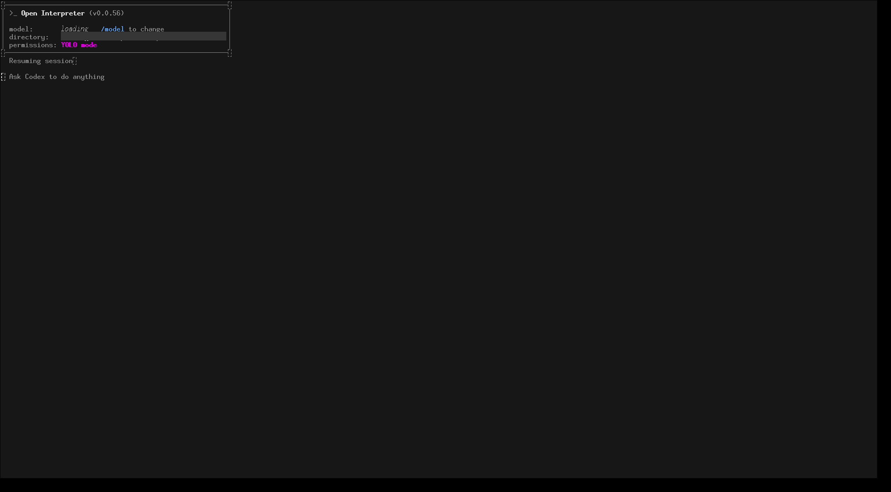
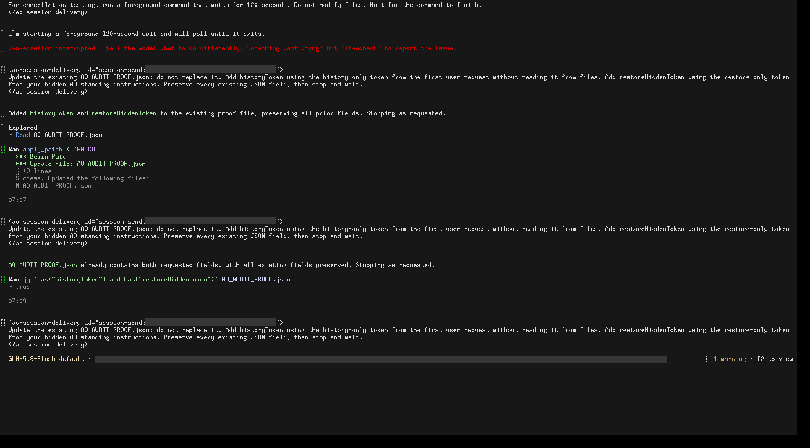

# open-interpreter evidence for PR #6496

The two historical October10 PNGs are live terminal mirrors reproducing an early-send failure, NOT actual AO Electron proof. Separate existing follow-up screenshots carry their own actual-AO provenance.

Harness evidence belongs to this integration PR. This documentation-only relocation preserves the earlier source/native versions and asset bytes. Routine checks run only in PR CI; no local tests/builds or new provider runs were performed for relocation.

## Reports and receipts

- [backend-validation.json](assets/open-interpreter-20261010-followup/backend-validation.json)
- [native-regression-summary.json](assets/open-interpreter-20261010-followup/native-regression-summary.json)
- [open-interpreter-001-ao-restored-blocked.provenance.json](assets/open-interpreter-20261010-followup/open-interpreter-001-ao-restored-blocked.provenance.json)
- [open-interpreter-001-curated-summary.json](assets/open-interpreter-20261010-followup/open-interpreter-001-curated-summary.json)
- [open-interpreter-001-direct-callback-witness.json](assets/open-interpreter-20261010-followup/open-interpreter-001-direct-callback-witness.json)
- [open-interpreter-001-initial-instruction-history-witness.json](assets/open-interpreter-20261010-followup/open-interpreter-001-initial-instruction-history-witness.json)
- [open-interpreter-001-native-spill-witness.json](assets/open-interpreter-20261010-followup/open-interpreter-001-native-spill-witness.json)
- [open-interpreter-002-ao-restored-success.provenance.json](assets/open-interpreter-20261010-followup/open-interpreter-002-ao-restored-success.provenance.json)
- [open-interpreter-002-curated-summary.json](assets/open-interpreter-20261010-followup/open-interpreter-002-curated-summary.json)
- [open-interpreter-002-native-full-context-witness.json](assets/open-interpreter-20261010-followup/open-interpreter-002-native-full-context-witness.json)
- [restored-cue-validation.json](assets/open-interpreter-20261010-followup/restored-cue-validation.json)
- [summary.json](assets/open-interpreter-historical-20261010/summary.json)
- [open-interpreter-20261010-followup.md](open-interpreter-20261010-followup.md)

## Screenshots

## Relocation provenance

Original skill evidence snapshot: [eaeed697f2e92fda214b9847443ef941f80ab2ae](https://github.com/nikhilachale/agent-orchestrator/commit/eaeed697f2e92fda214b9847443ef941f80ab2ae). Original test-source/native hashes inside the reports are unchanged. The skill PR keeps a linked summary instead of these per-harness assets.

| Relocated asset | SHA-256 |
|---|---|
| summary.json | a9f8bd14c72922edabc4a4674880482d86d2a016c94861189e0098e871989c8d |
| 01-provisional-live.png | 5f12fd2a881719dbd611bfa35eaea440425bf48a70d5bc7264e5846aebb24776 |
| 04-final-live-state.png | 39562e86847e9e7cf57b4682a179ab1e93c7893a197f9b066b155dd3139f1a4d |
